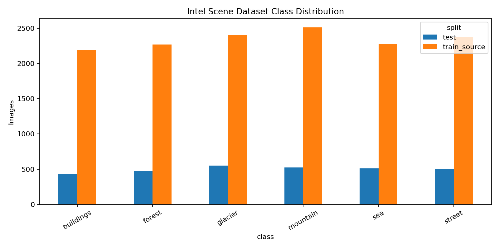
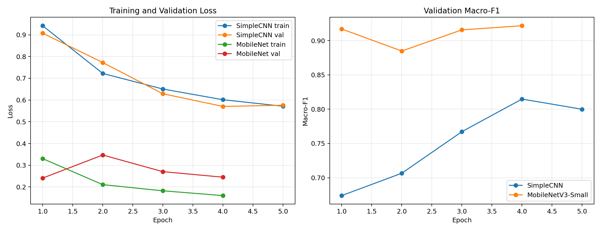
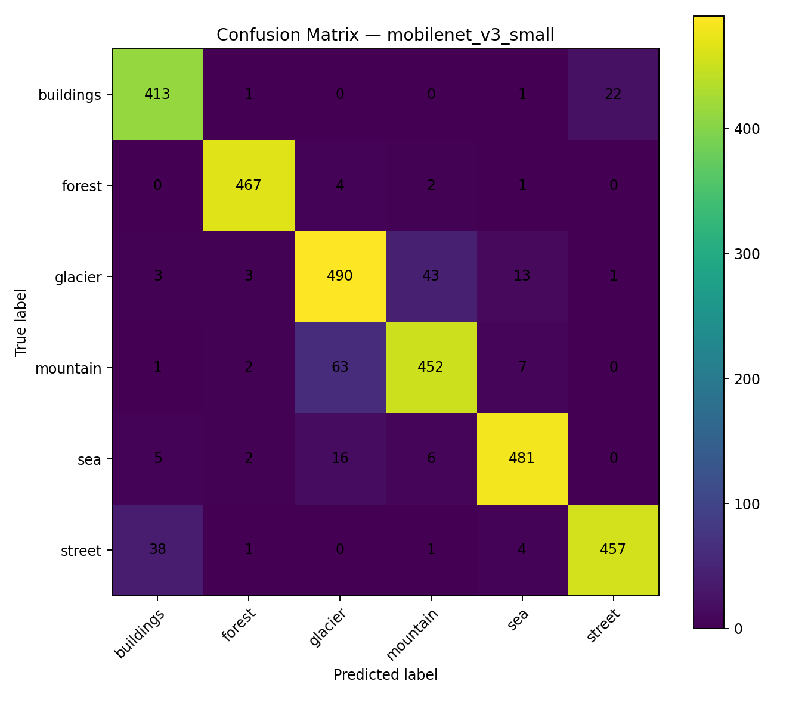
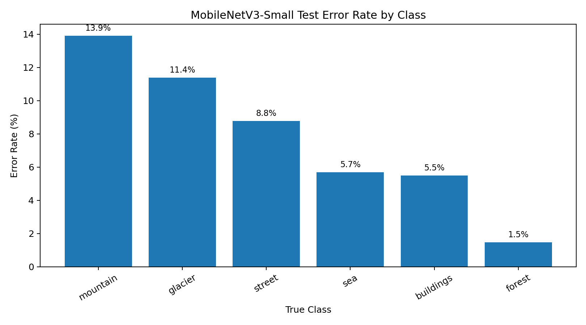
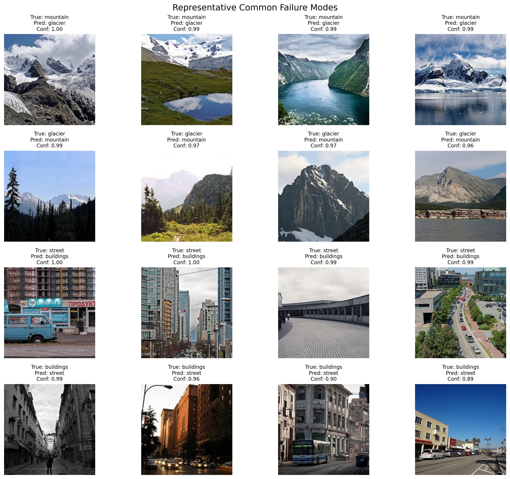
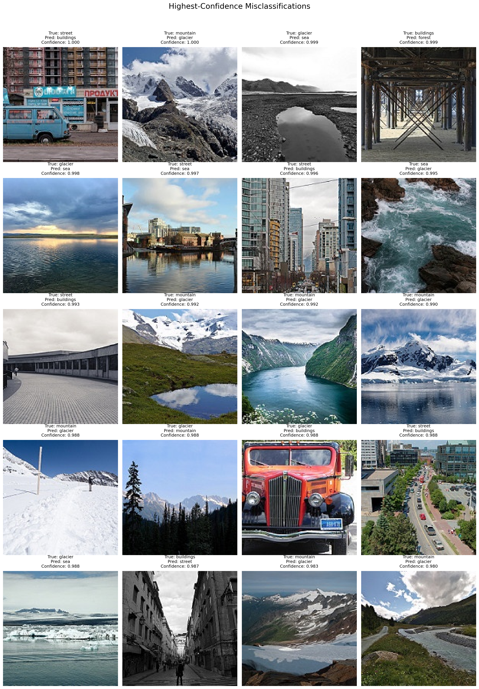

# Spark AI Natural Scene Classification

Computer Vision focused **AI / Machine Learning Engineer technical assessment** for Spark AI.

This project implements an end-to-end multiclass image-classification workflow using the public **Intel Image Classification** dataset. It includes dataset auditing, two-model comparison, controlled hyperparameter tuning, test evaluation, quantitative and qualitative error analysis, ONNX export, FastAPI inference, Docker support, automated API tests, and public deployment.

## Live Deployment

- **API:** https://spark-ai-scene-classification-production.up.railway.app
- **Swagger UI:** https://spark-ai-scene-classification-production.up.railway.app/docs
- **Health:** https://spark-ai-scene-classification-production.up.railway.app/health

The production service uses **ONNX Runtime** instead of PyTorch to keep inference lightweight.

---

## Problem

Given a natural-scene image, classify it into one of six categories:

- buildings
- forest
- glacier
- mountain
- sea
- street

The task is non-trivial because some categories have strong visual overlap, especially:

- mountain vs glacier
- buildings vs street
- sea vs glacier

---

## Dataset

**Dataset:** Intel Image Classification  
**Kaggle slug:** `puneet6060/intel-image-classification`

### Why this dataset?

Intel Image Classification was selected because it provides a sufficiently large, real-world multiclass computer-vision problem while remaining practical under the assessment's time and compute constraints. Its six scene categories are reasonably balanced but contain meaningful visual ambiguity—particularly mountain/glacier and buildings/street—which makes it suitable for comparing a simple CNN against transfer learning and for performing meaningful error analysis.

### Label format

Labels are encoded through the dataset directory structure, with one folder per class:

```text
buildings/
forest/
glacier/
mountain/
sea/
street/
```

The pipeline loads these folder-based categorical labels using PyTorch `ImageFolder`.

The provided labeled `seg_train` split was used as the training source and divided deterministically into training and validation subsets. The provided labeled `seg_test` split was kept untouched until final evaluation.

### Dataset split

| Split | Images |
|---|---:|
| Training | 11,928 |
| Validation | 2,106 |
| Final test | 3,000 |
| Total labeled images | 17,034 |

### Dataset audit

Training-source class distribution:

| Class | Images |
|---|---:|
| buildings | 2,191 |
| forest | 2,271 |
| glacier | 2,404 |
| mountain | 2,512 |
| sea | 2,274 |
| street | 2,382 |

Audit findings:

- **0 corrupt images**
- All audited images were RGB
- Most images were `150 × 150`
- A small number had different aspect ratios
- Class imbalance was mild, so class weighting was not used
- Macro-F1 was used alongside accuracy to keep evaluation class-aware



### Potential label noise

Qualitative inspection identified at least one potentially inconsistent test sample, including an urban vehicle scene located in the `glacier` directory.

Because the provided test set was intentionally preserved as an untouched final evaluation set, suspected labels were **documented rather than manually corrected or removed after evaluation**. This avoids post-hoc modification of the test set and keeps the reported metrics reproducible.

---

## Data Preparation

The pipeline includes:

- RGB conversion
- resizing to model input size
- random augmentation for training
- deterministic preprocessing for validation and test
- ImageNet normalization for MobileNetV3
- deterministic stratified train/validation splitting
- untouched final test evaluation

This keeps model comparison fair and prevents test-set leakage.

---

## Models

### 1. SimpleCNN — Baseline

A lightweight convolutional neural network trained from scratch.

Purpose:

- establish a genuine non-pretrained baseline
- verify the data pipeline independently of transfer learning
- provide a defensible comparison against the stronger model

### 2. MobileNetV3-Small — Final Model

An ImageNet-pretrained `MobileNetV3-Small` model was selected because it provides:

- strong transfer-learning performance
- low parameter count
- fast training
- efficient CPU inference
- a small deployment artifact

---

## Hyperparameter Tuning

A deliberately small controlled search was used because the assessment emphasizes practical engineering decisions rather than brute-force experimentation.

The MobileNetV3 backbone was initially frozen and three learning rates were compared for two epochs:

| Learning Rate | Best Validation Macro-F1 |
|---:|---:|
| **0.001** | **0.9016** |
| 0.0003 | 0.8944 |
| 0.0001 | 0.8828 |

`0.001` was selected for the final training run.

The final MobileNetV3-Small run reached:

**Best validation macro-F1: 0.9217**



---

## Final Test Results

The final evaluation used the untouched 3,000-image test split.

| Model | Accuracy | Macro Precision | Macro Recall | Macro F1 |
|---|---:|---:|---:|---:|
| SimpleCNN | 0.8127 | 0.8234 | 0.8144 | 0.8147 |
| **MobileNetV3-Small** | **0.9200** | **0.9219** | **0.9221** | **0.9217** |

MobileNetV3-Small improved macro-F1 by approximately **10.7 percentage points** over the from-scratch baseline.

### Final model error rate by class

| Class | Error Rate |
|---|---:|
| forest | 1.48% |
| buildings | 5.49% |
| sea | 5.69% |
| street | 8.78% |
| glacier | 11.39% |
| mountain | 13.90% |

Forest was the strongest class, while mountain and glacier were the most difficult because of their strong visual similarity.





---

## Error Analysis

The final MobileNetV3-Small model produced:

- **3,000** test predictions
- **2,760** correct predictions
- **240** errors
- **8.0%** overall error rate
- mean confidence on correct predictions: **0.9524**
- mean confidence on incorrect predictions: **0.7465**
- **59** incorrect predictions with confidence >= 0.90

### Most common confusion pairs

| True Class | Predicted Class | Count |
|---|---|---:|
| mountain | glacier | 63 |
| glacier | mountain | 43 |
| street | buildings | 38 |
| buildings | street | 22 |
| sea | glacier | 16 |
| glacier | sea | 13 |

The main failure modes are visually reasonable:

- snowy mountain scenes can resemble glaciers
- glacier scenes containing water can resemble sea scenes
- street scenes often contain buildings as dominant visual features
- building scenes can contain strong street context



### High-confidence misclassifications

High-confidence mistakes were inspected separately because they are useful for identifying model blind spots and potential dataset issues.



### Improvement hypotheses from observed failures

The dominant mountain/glacier errors suggest that higher-resolution inputs and augmentations that preserve fine texture may help distinguish snow-covered terrain from glacier structures. Street/building confusions may benefit from features that better preserve broader spatial context. Confidence calibration could also reduce the impact of high-confidence mistakes.

---

## ONNX Export

The selected MobileNetV3-Small checkpoint was exported from PyTorch to ONNX for deployment.

Deployment artifact:

```text
models/best_model.onnx
```

Approximate size:

```text
5.82 MB
```

PyTorch vs ONNX numerical validation produced:

```text
max_abs_diff = 2.14577e-06
```

The very small difference indicates effectively equivalent outputs between the original PyTorch model and the exported ONNX model.

---

## API

The FastAPI service exposes:

```text
GET  /
GET  /health
GET  /docs
POST /predict
```

Run locally:

```bash
pip install -r requirements-api.txt
uvicorn api.main:app --host 0.0.0.0 --port 8000
```

Example request:

```bash
curl -X POST \
  -F "file=@sample.jpg" \
  http://127.0.0.1:8000/predict
```
### Example Live Response

Example response from a single request to the live Railway deployment:

```json
{
  "predicted_class": "mountain",
  "confidence": 0.9000465869903564,
  "top3": [
    {
      "class": "mountain",
      "confidence": 0.9000465869903564
    },
    {
      "class": "glacier",
      "confidence": 0.0997079610824585
    },
    {
      "class": "sea",
      "confidence": 0.00016264538862742484
    }
  ],
  "latency_ms": 390.55
}
```
latency_ms represents the inference latency observed for this individual live request. It should not be interpreted as average latency, p95/p99 latency, or a formal performance benchmark.

The model is loaded once when the application starts.

If the model artifacts are missing, the service starts in a degraded state instead of crashing.

---

## Deployment Architecture

```text
Intel Image Dataset
        |
        v
PyTorch training on Kaggle GPU
        |
        v
MobileNetV3-Small
        |
        v
ONNX export
        |
        v
FastAPI + ONNX Runtime
        |
        v
Docker
        |
        v
Railway public deployment
```

PyTorch is intentionally excluded from the production inference service to reduce deployment size and memory requirements.

---

## Project Structure

```text
api/
    main.py                 FastAPI application

src/
    audit.py                Dataset auditing
    config.py               Shared configuration
    data.py                 Dataset loading and splitting
    transforms.py           Preprocessing and augmentation
    models.py               SimpleCNN and MobileNetV3
    train.py                Training pipeline
    tune.py                 Controlled hyperparameter search
    evaluate.py             Test evaluation
    error_analysis.py       Quantitative/qualitative failure analysis
    inference.py            ONNX Runtime inference
    export_onnx.py          PyTorch -> ONNX export
    utils.py                Utilities

models/
    best_model.onnx
    class_names.json

outputs/
    metrics/
    plots/
    error_analysis/
    tuning/

tests/
    test_api.py

docs/
    architecture.md

Dockerfile
requirements.txt
requirements-api.txt
```

---

## Testing

Run:

```bash
pytest -q
```

Current API test result:

```text
6 passed
```

The tests cover:

- health endpoint behavior
- valid prediction response
- invalid MIME type
- invalid image data
- empty upload
- unavailable-model handling

---

## Engineering Decisions

- Used a real multiclass public dataset rather than a trivial benchmark
- Preserved an untouched final test split
- Compared a from-scratch CNN against transfer learning
- Used a small controlled hyperparameter search instead of expensive brute-force tuning
- Selected checkpoints using validation macro-F1
- Performed both quantitative and qualitative error analysis
- Exported the final model to ONNX for lightweight CPU inference
- Kept training dependencies separate from production-serving dependencies
- Used Docker for reproducible deployment
- Designed the API to degrade gracefully if model artifacts are unavailable

---

## Limitations

- Visually overlapping classes remain difficult, especially mountain vs glacier
- A small number of labels may be noisy or semantically ambiguous
- Hyperparameter tuning was intentionally limited because of assessment time and compute constraints
- The learning-rate sweep was performed with the MobileNet backbone frozen, then the selected learning rate was reused for final full-network fine-tuning
- Images are relatively low resolution
- Confidence calibration was analyzed but not explicitly optimized

---

## With Additional Compute

With additional compute, I would scale training using:

- mixed-precision GPU training
- higher-resolution inputs
- larger batch sizes where GPU memory permits
- longer fine-tuning with early stopping
- learning-rate scheduling
- a broader but still controlled hyperparameter search
- multiple controlled runs to estimate training variance

I would also explore:

- larger MobileNet or EfficientNet variants
- stronger augmentation policies
- systematic review of ambiguous/noisy labels
- probability calibration
- robustness testing under blur, lighting changes, crops, compression, and other distribution shifts

---

## Reproducibility

Training was performed on a Kaggle Tesla T4 GPU.

The repository includes:

- deterministic split logic
- configurable parameters
- saved tuning results
- training histories
- model comparison metrics
- per-class classification reports
- prediction-level test outputs
- error-analysis artifacts
- ONNX deployment files

The project intentionally prioritizes **clean ML methodology, explainability of decisions, reproducibility, and deployment readiness** over chasing state-of-the-art benchmark accuracy.
